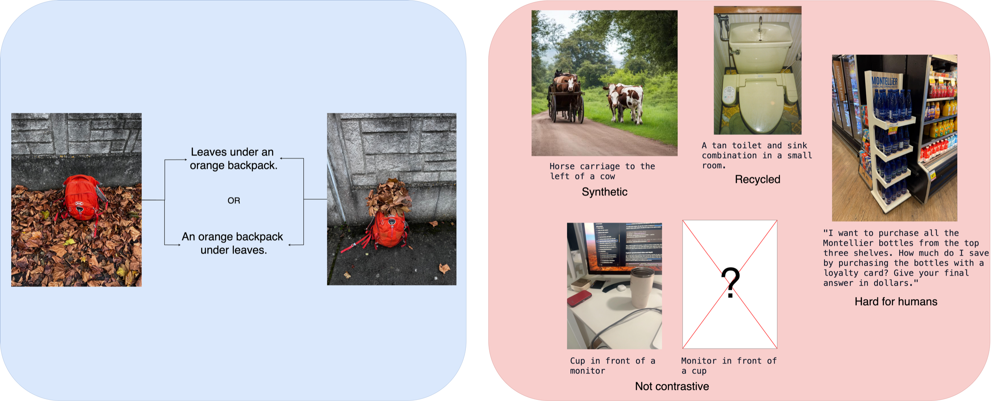

# RocketScience

**[Read the paper](https://arxiv.org/abs/2509.02175)** · [Dataset](https://huggingface.co/datasets/nilshoehing/rocketsciencebench) · [Evaluation notebook](RocketScienceEval_Release.ipynb) · [OpenBench](https://github.com/groq/openbench)

**Understanding Space Is Rocket Science**

*Only Top Reasoning Models Can Solve Spatial Understanding Tasks*

RocketScience is a contrastive benchmark for spatial understanding in vision-language models. It uses real-world images and captions that differ in spatial relationships, testing whether models can distinguish where objects are relative to one another.

## Quickstart: run with OpenBench

RocketScience is integrated into [Groq's OpenBench](https://github.com/groq/openbench), an evaluation framework built on Inspect AI. Use a model that supports image inputs; the example below evaluates GPT-4o through OpenAI.

With Python 3.10+ and [uv](https://docs.astral.sh/uv/getting-started/installation/) installed:

```bash
# Create an environment and install OpenBench.
uv venv
source .venv/bin/activate
uv pip install openbench

# Set your provider's API key.
export OPENAI_API_KEY="your-api-key"

# Try 8 samples (2 complete contrastive groups).
bench eval rocketscience --model openai/gpt-4o --temperature 0 --limit 8

# Run the full benchmark.
bench eval rocketscience --model openai/gpt-4o --temperature 0

# Explore results and logs (saved to ./logs/ by default).
bench view
```

To evaluate another vision-language model, replace `openai/gpt-4o` with its OpenBench provider/model identifier and set the corresponding [provider API key](https://github.com/groq/openbench#supported-providers).

### How the integration works

OpenBench automatically loads [`nilshoehing/rocketsciencebench`](https://huggingface.co/datasets/nilshoehing/rocketsciencebench) from Hugging Face. Each dataset row contains two images and two captions, which become **four evaluation samples**: two caption-selection questions and two image-selection questions. The adapter pins the dataset revision for consistency and prompts models to reason before returning a final `1` or `2`.

| Metric | A contrastive group is correct when… |
| --- | --- |
| **Text score** | Both caption-selection questions are correct. |
| **Image score** | Both image-selection questions are correct. |
| **Group score** | All four questions are correct. |

Scores are averaged across contrastive groups. **When using `--limit`, choose a multiple of 4** to keep groups complete.

The implementation lives in OpenBench's [task](https://github.com/groq/openbench/blob/main/src/openbench/evals/rocketscience.py), [dataset adapter](https://github.com/groq/openbench/blob/main/src/openbench/datasets/rocketscience.py), and [metrics](https://github.com/groq/openbench/blob/main/src/openbench/metrics/rocketscience.py). For comparable results, record the OpenBench version, model, and generation settings; see its [reproducibility statement](https://github.com/groq/openbench#reproducibility-statement).

## The benchmark at a glance

[](https://arxiv.org/html/2509.02175v2#S1.F1)

*Figure 1 from the [paper](https://arxiv.org/abs/2509.02175). Left: a RocketScience contrastive pair with the same objects in different spatial arrangements. Right: examples illustrating limitations of other benchmarks. See the original figure caption for source credits and licenses.*

The dataset contains **241 contrastive groups (482 image–caption pairs)** covering spatial relations and object order. The paper evaluates CLIP-style models, vision-language models, and reasoning models, and includes an analysis separating object localization from spatial reasoning.

## Run the original evaluation notebook

This repository contains the original evaluation code in [`RocketScienceEval_Release.ipynb`](RocketScienceEval_Release.ipynb). It is designed for **Google Colab**, with a [`requirements.txt`](requirements.txt) provided for local use.

### Google Colab

[Open the notebook in Colab](https://colab.research.google.com/github/nilshoehing/rocketscience/blob/main/RocketScienceEval_Release.ipynb)

1. Fill in the API keys required for the models you want to evaluate and leave `COLAB = True`.
2. Run the **Setup for all models** and **Model-Interface** sections.
3. Choose models in the **CLIP models** or **VLMs** section, then run that section's evaluation cells.
4. Use **Localisation Experiment** to run the object-localization analysis from Section 5.1 of the paper.

### Local setup

```bash
git clone https://github.com/nilshoehing/rocketscience.git
cd rocketscience
python -m venv .venv
source .venv/bin/activate
python -m pip install -r requirements.txt jupyter pandas pillow requests
jupyter notebook RocketScienceEval_Release.ipynb
```

Set `COLAB = False`, enter the keys required for your selected models, and follow the same notebook sections above. Local model evaluation requires hardware appropriate for the selected model.

The notebook downloads the dataset automatically and saves model response logs and score CSV files in `RocketScienceResults/` (under `MyDrive` when running in Colab).

## Dataset

Browse or download the images, captions, and category annotations on [Hugging Face](https://huggingface.co/datasets/nilshoehing/rocketsciencebench). The dataset is released under **CC BY 4.0**.

## Citation

If you use RocketScience in your research, please cite:

```bibtex
@misc{hoehing2025understandingspacerocketscience,
  title         = {Understanding Space Is Rocket Science -- Only Top Reasoning Models Can Solve Spatial Understanding Tasks},
  author        = {Nils Hoehing and Mayug Maniparambil and Ellen Rushe and Noel E. O'Connor and Anthony Ventresque},
  year          = {2025},
  eprint        = {2509.02175},
  archivePrefix = {arXiv},
  primaryClass  = {cs.CV},
  url           = {https://arxiv.org/abs/2509.02175}
}
```
